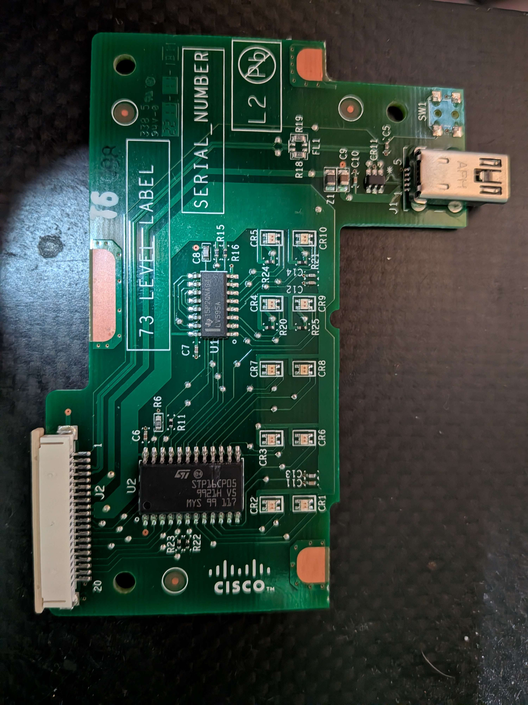

# Cisco Catalyst 3560-X front-panel PCB — reverse engineering

**Status:** meter-derived reconstruction, rev 0.7 (23 November 2026); not
independently powered or validated in KiCad. This documentation was
assembled from continuity and visual observations on a salvaged original Cisco PCB.

## What is on this board?

- **J2:** 20-contact connection to the original Cisco mainboard.
- **U1:** TI SN74LV595A, 8-bit serial-in/parallel-out register.
- **U2:** ST STP16CP05, 16-channel constant-current sink and shift register.
- **CR1–CR10:** ten two-colour, two-die LED packages (20 LED cathodes total).
- **J1:** USB mini-B connector, wired through to the motherboard header;
  the front-panel PCB does not implement a USB controller.
- **SW1:** unpopulated front-panel pushbutton footprint.
- USB-side ESD/filter and various passive components are present but not
  all have been completely identified.

## Start here

| Resource | Purpose |
|---|---|
| [J2 pinout](docs/j2-pinout.md) | Connector orientation, signals and evidence |
| [LED driver mapping](docs/led-driver.md) | 24-bit chain, outputs, LED colours, resistor arrangements |
| [Circuit/component notes](docs/components.md) | ICs, resistor values, voltage and USB discussion |
| [Open checks](docs/open-checks.md) | What still needs measuring/confirming |
| [Original Rev 0.7 notes](docs/reconstruction-notes-rev07.md) | Prior reconstruction notes retained for traceability |
| [KiCad reverse-engineering schematic](kicad/cisco-3560x-front-panel-re.kicad_sch) | Editable drawing, with embedded custom symbols |
| [Measurements](measurements/) | Source CSV tables (not just inferred net names) |
| [Photograph with J2 pins labelled](photos/j2-pins-numbered.png) | Numbering used by the documentation |

## Critical warning: logic supply not yet confirmed

**J2 pins 9 and 10 feed the ICs' logic supply, but the operating voltage
has not been measured.** 3.3 V looks more likely than 5 V on current-budget
grounds; this is an **inference**, not a supply specification. USB VBUS
on pins 6/7 is a separate net. Do not directly connect this assembly to
external logic or energise it based on the inferred supply voltage.

## Evidence conventions

- **Measured:** user-reported continuity, resistor marking/resistance,
  or diode-mode observation on the unpowered board.
- **Traced visually:** follows copper visible in the photograph but not
  yet checked end-to-end with a meter (e.g. J2/12).
- **Inferred:** function based on chip datasheets, IC behaviour or layout.
- **Unverified:** plausible/unfinished part of the schematic.

The physical LED pin numbers assume the same anticlockwise convention as U2
when viewed from the component side. The LED die pairing and colour were
checked by diode mode for **CR9 only**; other LED colours were not individually
assigned. No board part-number interchangeability is established.

## Source and reuse

The original photograph and measurements were made from a salvaged Cisco
board in November 2026. The KiCad file is a **reconstruction** of the
photographed hardware, not Cisco design data. Manufacturer reference
links are in [components.md](docs/components.md).
