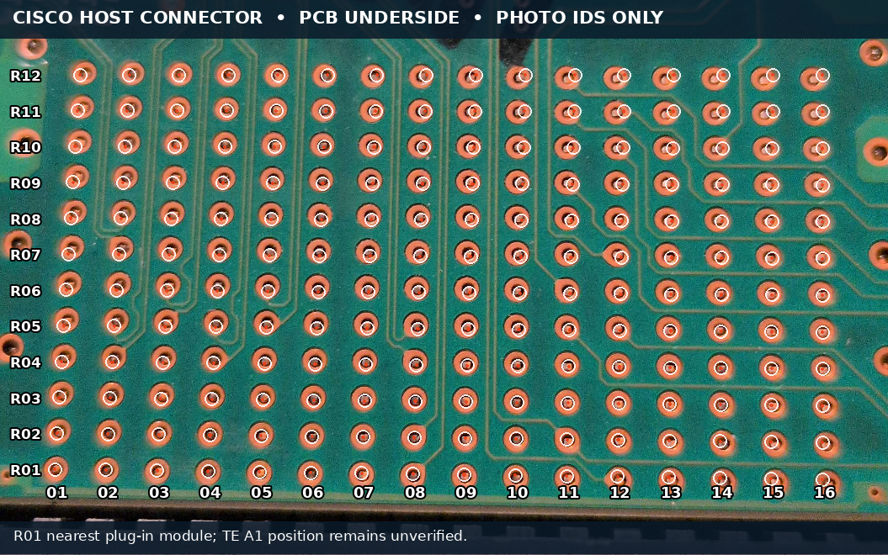

# Cisco network-module host: photographic pin registration

**Scope:** original Catalyst 3560-X/3750-X motherboard, underside, module connector at the *bottom* of the photograph. Original source photograph: `../photos/08-mainboard-contact-field-closeup.jpg` already supplied in the earlier repository update; this incremental update contains only its annotated derivative. This register documents visual hole locations, **not measured electrical nets**.

[Standalone vector reference](host-contact-grid-photographic-index.svg) | [192-position CSV with native-photo pixel coordinates](host-connector-photographic-grid-192.csv).

## Indexing rules

- 16 photo columns (`C01` left to `C16` right), 12 photo rows (`R01` closest to plugged-in module, up to `R12` toward the switch ASIC). Every `RxxCyy` is unique.
- Approximate centre locations in **native 1536 × 2048 source-photo pixels** are recorded as `(x,y)` in the CSV; estimated registration uncertainty approximately **±10 pixels** (photo-corner interpolation; actual residuals not metrologically certified) pending photogrammetric fitting. This is a **photographic lookup aid**, not physical metrology.
- Contact pitch in TE's manufacturer definition: **1.9 mm column-to-column, 1.4 mm row-to-row**. We do **not** treat the photographed pixels as dimensionally calibrated; perspective and optical distortion remain.
- TE's official rows `A`–`L` and columns `1`–`16` have **not yet been mapped to these photo indexes**. TE's customer drawing labels its PCB footprint as *component side shown*, whereas this photograph is the **underside**. Converting them requires choosing the correct mirror/key orientation and confirming the contact numbered A1. Do not assign TE names by guess.
- The host module's photo contact orientation is **not** necessarily the same as the sled's view: mating flips the apparent axes. Probe opposite contacts of the *mated unpowered assembly* to resolve it.

## Evidence behind the contact types

TE confirms 192 positions: **128 signal + 64 ground**, arranged as 64 differential pairs / four pairs per column. Its routing report describes **staggered grounding between adjacent columns**, so no uniform `SSGSSG...` pattern has been assumed. **Individual ground holes remain UNKNOWN** until verified against TP78/TP81; *visible trace absence does not prove ground or NC*.

## What this is not

The CSV is **not a Cisco motherboard connector pinout**. It is a reproducible coordinate system for the probe work that comes next. Connector mechanical position relative to original H01-H19 chassis survey is not yet established from this close-up alone: the mounting hole near the grid is not yet positively assigned an H ID.

## External references

- TE 1934318-1: https://www.te.com/en/product-1934318-1.html
- TE 1934225-1: https://www.te.com/en/product-1934225-1.html
- TE/AMP routing guide 27GC001-1: https://doczz.net/doc/6470255/i-n-t-e-r-c-o-n-n-e...-z-pack-tinman-connector-routing-re...
- TE/Tyco TinMan catalog: https://www.farnell.com/datasheets/91659.pdf

## Relative KiCad grid

`kicad/host-connector-photographic-grid-LOCAL_ONLY.kicad_pcb` contains only **192 graphic markers on `Cmts.User`** and photograph-side row/column labels. No pads, no `Edge.Cuts`, no drill geometry and no electrical pin numbers are defined. It preserves TE nominal pitch but **is not positioned in the original whole-motherboard H01–H19 survey**, because the photographed nearby mounting hole has not been identified within that earlier hole register. It is intended to be imported into the mainboard survey *after* that registration is made.
