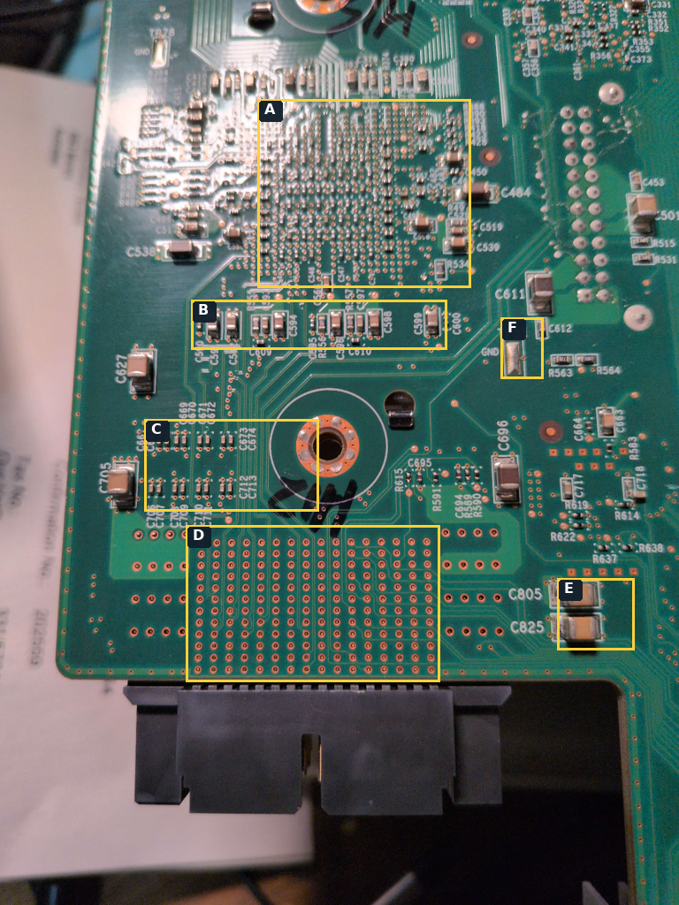

# C3KX-NM-10G: signal-path hypotheses and falsifiable tests

**Status 2026-11-24: preliminary forensic analysis, no confirmed XAUI signal-to-host contact continuity.** Ground/reference geometry is manufacturer-specified, but *Cisco net allocation* is unknown. This is a hypothesis ledger, not a pinout. [Feature register](photographic-feature-evidence.csv) and [photographic contact index](photo-grid-registration.md).

## Confidence language

- **M:** manufacturer documents connector or PHY properties (not the Cisco connection).
- **O:** visible PCB feature and silk designator.
- **H:** working hypothesis with a clear validating/disproving measurement.
- **X:** expressly unknown, not assumed absent. **C:** continuity-verified only when a meter measurement is recorded (none yet).

## Architecture fixed by published sources

- Broadcom BCM8727 offers **two XAUI MAC-facing links**, each four TX/RX differential lanes at **3.125 GBd**, and **two 10.3125 GBd SFI** optical-facing lanes. 16 XAUI differential pairs would enter the sled **if** both full XAUI interfaces are routed to the module connector.
- The four optical cages implement Cisco's 4×1G, 2×10G, and mixed-mode port combinations. Two gigabit-only cages cannot be explained by two 10G/SFI transceivers alone without additional paths/control architecture. A combination of 1.25GBd SerDes and PHY or mux arrangements is plausible but unverified.
- The module **does not** supply a four-port Ethernet MAC; host switch logic is required. No assumption is made that all connector 64 pair sites are populated with functional Ethernet signals.

## Cross-photo routing regions (new visual register)

| Region | Visible feature | Interpretation | Confidence |
|---|---|---|---|
| A | Dense BGA escape and fine traces toward small passive banks | Original switch/SerDes area, signal classes not proven | O, H |
| B | C590–C600 grouped parts between BGA and connector | Candidate AC-coupling bank; need measure which pad, if any, is grounded | O, H |
| C | C665–C674 and C706–C713 clusters, visibly repeated and routed toward the host | Plausible multi-lane serial circuitry. **Speculative**: if all eight C706–C713 devices are populated in series on eight conductors, that's exactly the four differential serial pairs required for the two gigabit-only cages (each 1 TX + 1 RX pair). This numerical coincidence is **not evidence of the actual allocation**; the caps may belong to unrelated functions | O, H |
| D | Actual host 16×12 contact field and surface breakout | Geometry directly indexed in photograph | O |
| E | C805/C825 large passives | Possible power decoupling | O, H |
| F | TP81 `GND` silkscreen | Prime reference for ground-pattern survey | O |

The proposed G1/G3 interpretation of region C can be rejected promptly if the C706–C713 parts share ground pads (decoupling), if they connect to high-speed XAUI pair groups, or if they do not form eight independent signal nets.

## Working hypotheses (ranked)

| ID | Hypothesis | Evidence | Counter-explanation | Critical discriminator |
|---|---|---|---|---|
| H-X1 | The narrow parallel tracks from motherboard contact field toward C590–C600 and other capacitor arrays include XAUI host signals | O: repeated components, matched-width and parallel routing; M: XAUI required | Could be 1G SerDes, clock, or other high-speed signals; some capacitors may be decoupling | Find adjacent cap terminals whose *one* side reaches two side-by-side photo contacts with separate low-ohm nets; compare to sled vias |
| H-X2 | Four-pair XAUI lanes group in repeatable blocks matching TE's ground/side-by-side signal arrangement | M: 4 differential pairs/column, staggered shielding | Pins may be allocated non-contiguously among columns, including gigabit lane intermix | Continuity + ring-out every 3rd possible GND pin in two adjacent columns, then classify the remaining pairs |
| H-G1 | Two 1G-only SFP ports have independent 1.25GBd paths toward the host connector | O: repeated cage-associated passive clusters; Cisco 4×1G capability | Muxing, a second chip, or broad BCM multirate mode may service some paths | Trace cage RX/TX serial pin + coupling passives to BCM via vs connector field; compare with 1G-only network-module donor |
| H-G2 | The 10G-capable cages connect to BCM SFI pins; 1G mode may employ the same PHY | M: BCM two SFI channels, BCM supports 1000BASE-X | Hardware bypass/mux may be present; cannot infer from top-side photograph | Trace each cage high-speed pair to BCM package/vias and small ICs around cages |
| H-CLK1 | Reference clock may be generated locally on sled | O: support ICs/passives near BCM | Clock may arrive via host connector or both sources may be selectable | Identify an oscillator marking, check clock pins at package (Terasic ball reference), probe with suitable high-bandwidth scope only when powered safely |
| H-M1 | MDIO/MDC, reset and module-identification signals occupy non-high-speed connector contacts | M: BCM management required; O: small ICs and trace-via groups near connector | MDIO bridge or FPGA CPLD on sled may hide direct paths | Trace documented BCM MDIO/RESET pins to small ICs and connector; identify IC legends first |
| H-P1 | C805/C825 on motherboard are power rail decoupling, not XAUI coupling | O: large SMD components near board-to-board power contacts | They could be low-frequency filters or series capacitors | Check if one terminal is TP81 GND and other terminal common with spade contacts |

### Why the surface images cannot give lane names

Dense press-fit fanout disappears into multiple ground/signal layers; differential tracks can cross under BGA, and AC capacitors interrupt DC continuity. Even when a visible trace reaches contact `RxxCyy`, **TX/RX direction, polarity, port, lane index and rate** all remain unproved until the other end is identified. Similar spacing of two traces is *supporting evidence*, not proof of a differential pair.

### New external source: TE routing report

TE's `27GC001-1` explains 2:1 signal-ground ratio and **staggered grounding**. This is directly helpful: the first 64 verified GND contacts can disambiguate the correct TE grid orientation and restrict the 128 signal candidates without knowing anything about Cisco-specific routes.

### PCB component regions

- Motherboard: `C590–C600`, `C665–C674`, `C706–C713` **candidate coupling / equalised high-speed regions** (H; silkscreens observed, values and topology unknown). Don't combine nonconsecutive reference numbers into an assumed schematic chain.
- Motherboard: `C805/C825` potentially decoupling on power contacts (H).
- Motherboard: `TP78` / `TP81` labelled `GND` (O; confirm with continuity).
- Sled: BCM8727 BGA and via fanout centrally; multiple local switching-regulator inductors; repeated small circuitry near four SFP cages. The presence of multiple ICs establishes that a pure "connector directly to BCM" story may be incomplete. Their markings and precise nets need recording.

### Falsification notes

If testing reveals an apparently candidate 'AC-coupling capacitor' with one pin hard-grounded, reclassify as rail decoupling and **do not** continue treating its adjacent trace group as XAUI evidence. If a proposed signal-contact pad beeps to GND, correct the grid/ground hypothesis first. If a mated connection shows finite resistance due to termination, use the opposite accessible side of the series capacitor, not a contact-via jumper.

### References

1. Broadcom BCM8727 Product Brief: https://docs.broadcom.com/doc/12358272
2. Terasic Dual XAUI user manual: https://datasheet.ersaelectronics.com/static/datasheets/terasic/terasic-p0092.pdf
3. Intel/Altera AN638 interoperability demonstration: https://cdrdv2-public.intel.com/655128/an638.pdf
4. Cisco network module combinations: https://www.cisco.com/c/en/us/td/docs/switches/lan/catalyst3750x_3560x/hardware/install/notes/net_mod_note.html
5. TE routing report 27GC001-1: https://doczz.net/doc/6470255/i-n-t-e-r-c-o-n-n-e...-z-pack-tinman-connector-routing-re...
6. Linux `bnx2x` BCM8727 init code: https://codebrowser.dev/linux/linux/drivers/net/ethernet/broadcom/bnx2x/bnx2x_link.c.html
7. Linux `bcm87xx` clause-45 PHY: https://codebrowser.dev/linux/linux/drivers/net/phy/bcm87xx.c.html

## Candidate two-phase ground topology (NOT yet verified on this connector)

TE's generic four-pair-per-column geometry and staggered-ground routing description are consistent with two alternating row patterns: **SSG SSG SSG SSG** and **GSS GSS GSS GSS**, where each letter denotes one of the 12 TE row contacts, viewed in whichever direction makes the pattern true. We have **not** established that this exact pattern is implemented by the photographed 1934318 variant; this is a **testable engineering hypothesis**, not a manufacturer's pin assignment. We also do not know whether photograph C01 begins on the first or the second pattern.

[Two alternative 192-contact classifications (CSV)](tinman-two-phase-ground-HYPOTHESIS.csv) provides **two candidate phases**, both with 64 GND contacts and 128 signal contacts. Testing `R01C01`, `R03C01`, `R01C02` and `R03C02` against TP81 should distinguish these candidates quickly *if* the model is applicable. It is crucial **not to treat a negative ground beep as proof of signal**: it can equally indicate an indexing error, high-resistance ground link, a different manufacturer's contact assignment or bad probing. Confirm across several alternating columns before promoting a pattern to measured ground.
